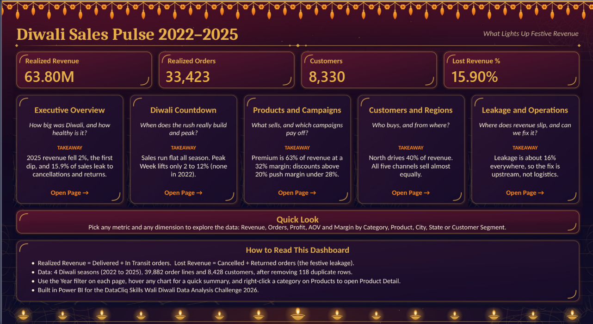

# 🪔 Diwali Sales Pulse 2022–2025
### 🥇 1st Place — DataCliq Skills Wali Diwali Data Analytics Challenge 2026

## 📌 Project Overview

Diwali Sales Pulse is a multi-page, Diwali-themed Power BI dashboard built for the **DataCliq – Skills Wali Diwali Data Analytics Challenge 2026**, where it won **1st place among 50+ participants**.

It analyses 40,000+ raw retail orders across four Diwali seasons (2022–2025) to understand sales trends, product performance, customer behaviour, regional contribution, discount and campaign impact, and revenue leakage.

## 🔍 Key Insights

- **Growth stalled in 2025:** revenue grew strongly from 2022 to 2024, then dipped about 2% in 2025, with orders down about 3%.
- **Sweets lead on revenue, but not on margin:** Decor & Pooja (~48%) and Chocolates (~44%) earn higher margins than Dry Fruits (~29%).
- **Discounts burn margin:** profit margin falls from ~42% (no discount) to ~17% (30% discount), while revenue peaks at around 10% discount.
- **The North region leads:** North contributes about 40% of realised revenue, nearly four times Central.
- **~16% of revenue leaks:** about ₹1.21 Cr (cancellations and returns combined) is lost, and the rate is similar across categories, channels and regions, which points to a systemic issue.
- **Diwali demand is a plateau, not a spike:** the week before Diwali is only about 5% above the baseline.
- **Campaigns showed no clear lift:** orders without a campaign sold about as much as campaign orders.

## 💡 Recommendations

- Cap discounts near 10% and protect margin on Dry Fruits.
- Investigate the cancellation and return process, since the leakage is broad-based rather than tied to one segment.
- Re-test campaign design, and build pre-Diwali peaks instead of relying on a flat season.
- Invest in the North and in under-penetrated regions such as Central and East.

## 🧹 Data Cleaning & Modelling

- Removed 118 exact duplicate rows (40,000 → 39,882) and kept shared Order IDs by using a composite order key.
- Rebuilt order dates from the Diwali day offset because the raw dates came in mixed formats (dd/mm and mm/dd).
- Standardised category, channel, payment and city values (for example Bangalore → Bengaluru), and recovered missing states from cities.
- Separated **Realised Revenue** (Delivered + In Transit) from **Lost Revenue** (Cancelled + Returned) instead of reporting raw net sales.
- Built a star schema with a custom date table (including Diwali-aligned fields) and a dedicated measures table.

## 🛠️ Tools & Technologies

- **Power BI** – dashboard development and storytelling
- **Power Query** – data cleaning and transformation
- **DAX** – measures, time intelligence, dynamic calculations
- **Excel** – dataset exploration

## 📊 Dashboard Pages

1. **Executive Overview** – overall sales performance and key business metrics.
2. **Diwali Countdown** – sales trends in the days before and after Diwali.
3. **Products & Campaigns** – category, discount and campaign performance.
4. **Customers & Regions** – segments, channels and regional analysis.
5. **Operations** – cancellations, returns, delivery performance and revenue leakage.

## 🖼️ Dashboard Preview

### Home Page


### Executive Overview


## 📁 Repository Structure

```text
DataCliq-Diwali-Data-Analytics-Challenge/
├── Assets/
│   └── GitHub_Cover_1280x640.png
├── Dashboard/
│   └── Diwali_Sales_Pulse.pdf
├── Screenshots/
│   ├── Home.png
│   └── Executive Page.png
└── README.md
```

## 📄 Dashboard Access

The dashboard PDF is available in the `Dashboard/` folder.

**Power BI file (.pbix):** available on request. Feel free to contact me to explore the interactive dashboard or the Power BI implementation.

## 🙏 Acknowledgement

Thank you to **DataCliq** for organising the Skills Wali Diwali Data Analytics Challenge 2026.

## 👨‍💻 Author

**Piyush Dave** — Data Analyst

- [GitHub](https://github.com/PiyushDave30)
- [LinkedIn](https://linkedin.com/in/piyushdave30)
- [Portfolio](https://piyushdave30.github.io/)

#SkillsWaliDiwali #DataAnalytics #PowerBI
